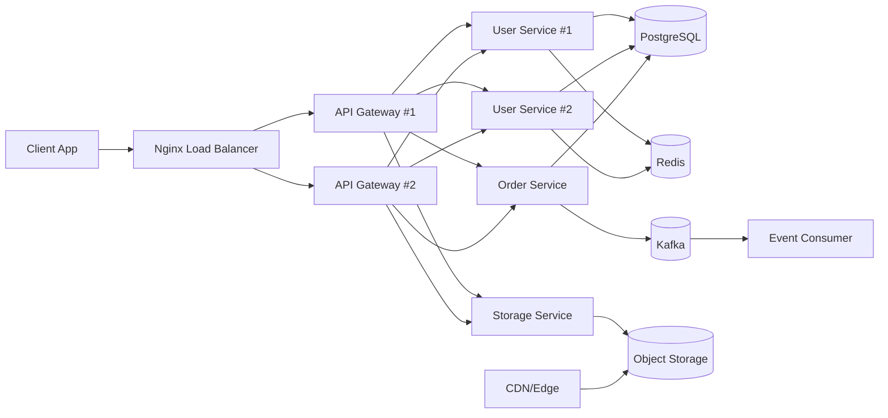

# Distributed API System Design (Local Build)

This project implements an API using core system design building blocks:

1. Load balancer (Nginx)
2. API gateway (Express)
3. CDN strategy (documented for cloud edge)
4. Rate limiter (Redis-backed)
5. Microservices (user, order, storage)
6. Kafka message queue (order events)
7. VPC design (Terraform baseline)
8. DB storage (PostgreSQL)
9. Redis cache
10. Object storage (MinIO/S3-compatible)

## Architecture



## Quick Start

1. Copy `.env.example` to `.env` and adjust if needed.
2. Run:

```bash
docker compose up --build
```

3. Hit API through load balancer:

- `GET http://localhost/health`
- `GET http://localhost/docs` (Swagger UI)
- `GET http://localhost/docs.json` (OpenAPI JSON)
- `POST http://localhost/api/users`
- `GET http://localhost/api/users/:id`
- `POST http://localhost/api/orders`
- `GET http://localhost/api/orders/:id`
- `POST http://localhost/api/storage/presign-upload`

4. Check which gateway handled a call:

```bash
curl -i http://localhost/health
```

Look for response header `x-gateway-id` (value will be `api-gateway-1` or `api-gateway-2`).

You can run multiple calls to observe load balancing:

```bash
for i in {1..6}; do curl -s -D - http://localhost/health -o /dev/null | grep -i x-gateway-id; done
```

## Example Requests

Create user:

```bash
curl -X POST http://localhost/api/users \
  -H "Content-Type: application/json" \
  -d '{"name":"Alex","email":"alex@example.com"}'
```

Create order:

```bash
curl -X POST http://localhost/api/orders \
  -H "Content-Type: application/json" \
  -d '{"user_id":1,"item":"Keyboard","amount":89.99}'
```

Generate pre-signed upload URL:

```bash
curl -X POST http://localhost/api/storage/presign-upload \
  -H "Content-Type: application/json" \
  -d '{"objectName":"avatars/user-1.png","contentType":"image/png"}'
```

## Visual Demo: Object Storage Request Flow

A small static UI illustrates which API gateway instance handles an object storage
request, served by Nginx alongside the API:

- `http://localhost/ui/`

Click "Send 1 storage request" or "Send 10 requests" to watch the request path
(Browser → Load Balancer → API Gateway 1/2 → Storage Service → Object Storage)
light up based on the `x-gateway-id` response header, with a running count per gateway.

## Notes

- Local environment demonstrates the distributed behavior.
- CDN and VPC are represented with production-ready design artifacts in `cdn/` and `infra/terraform/`.
